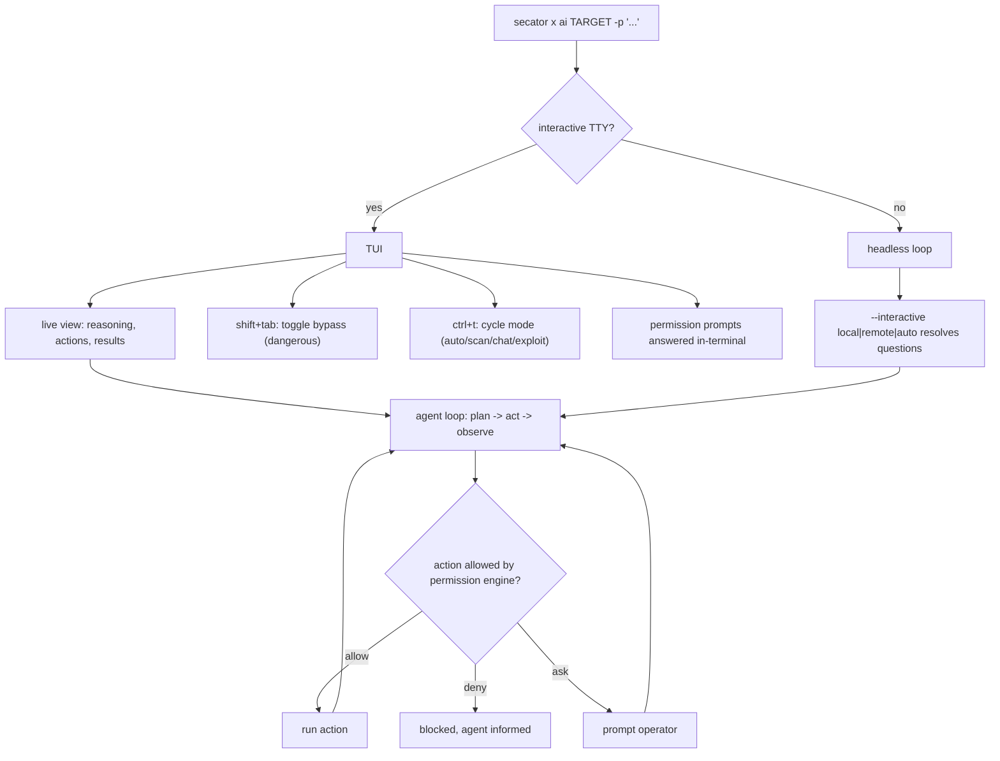
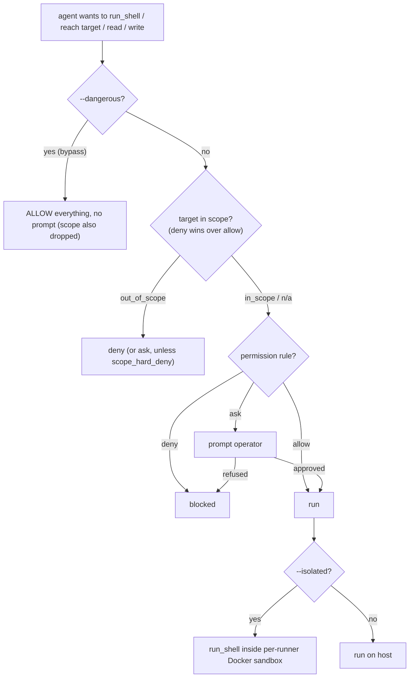

# AI task

The `ai` task is an autonomous security assistant that drives `secator` from
natural language. You give it a target and a prompt; it reasons in a loop, runs
`secator` tasks and workflows, executes shell commands, queries your workspace
findings, records results, and explains what it found - all under a permission
engine you control.

It is an ordinary `secator` task, so everything you know about targets, drivers,
workspaces, and output already applies:

```bash
secator x ai testphp.vulnweb.com -p "Scan this host for vulnerabilities"
```


**Only run the `ai` task against targets you are authorized to test.** The agent
can actively scan, fuzz, and attempt exploitation. Keep it inside a scope you own
or have explicit permission to assess (see [Restrict scope](#restrict-scope)).


***

## Installation

The AI capabilities ship as an addon. Install it, then run the setup wizard to
pick a model and store your API key:

```bash
secator install addons ai
secator x ai setup
```

If the addon is missing, the task exits with a reminder to run
`secator install addons ai`.

***

## Execution paths: TUI vs headless

How a run behaves depends on whether you launch it interactively (with a TTY) or
headless. Interactively, the task opens a full-screen **TUI** where you watch the
agent reason, answer its permission prompts, and toggle its mode/guardrails live.
Headless (no TTY, or driven from a calling application / another task), it runs
the same agent loop but resolves questions through the configured
`--interactive` backend instead of the terminal.



The TUI exposes two live toggles that are documented below: **shift+tab** toggles
[bypass-permissions (`--dangerous`)](#bypass-permissions---dangerous) and
**ctrl+t** cycles the [mode (`--mode`)](#modes---mode).

***

## The permission engine (how actions are gated)

Every action the agent attempts - reaching a target, reading/writing a path,
running a shell command, invoking a task/workflow - is checked against an allow /
deny / ask rule set **before** it runs. This is the core safety boundary, and it
combines with the optional [scope](#restrict-scope) boundary and
[isolation](#isolated-execution---isolated).



Rules live under `addons.ai.permissions` as `allow`, `deny`, and `ask` lists of
patterns over action classes: `target(...)`, `read(...)`, `write(...)`,
`shell(...)`, `task(...)`, `workflow(...)`. Evaluation order is **deny > allow >
ask > default-deny**: a deny always wins, an unmatched action falls through to
`ask`, and if nothing matches it is denied.

### Guardrail levels at a glance

The flags combine into escalating trust levels - from "gate everything" to
"trust the LLM". Each row shows which guardrail layers still apply:

| Mode | Command | Path | Target / scope | Approval prompts | Shell isolation |
|---|:---:|:---:|:---:|:---:|:---:|
| **default** | ✅ gated | ✅ gated | ✅ gated | yes | no |
| **`--in-scope` / `--out-of-scope`** | ✅ | ✅ | ✅ in-scope pre-approved | fewer¹ | no |
| **`--isolated`** | ❌ dropped² | ❌ dropped² | ✅ still enforced | targets only | ✅ Docker sandbox |
| **`--dangerous`** | ❌ | ❌ | ❌ scope dropped too | none | no |

¹ In-scope targets are pre-approved, so they don't prompt; out-of-scope targets
are denied (or prompt, unless `scope_hard_deny` is set). ² The sandbox container
*is* the command/filesystem boundary, so those layers drop to *allow* - but
network egress (targets) and sensitive-env access still gate.

***

## Bypass permissions - `--dangerous`

`--dangerous` is **bypass-permissions** mode: it skips **all** permission-engine
checks. Every action is accepted and you are never prompted.

```bash
secator x ai testphp.vulnweb.com -p "Exploit everything you can" --dangerous
```

In the TUI you can toggle it live with **shift+tab** (it flips the "bypass
guardrails" / "guardrails enforced" banner).


`--dangerous` removes the entire safety boundary. In the current implementation
it **also disables scope filtering** - `--in-scope` / `--out-of-scope` are
intentionally dropped when `--dangerous` is on, so nothing is filtered as
out-of-scope and child runners inherit no scope boundary. The agent can then run
any shell command, reach any target, and read/write any path the process can.
Use it only in a throwaway, fully isolated environment you own.


***

## Restrict scope - `--in-scope` / `--out-of-scope`

On top of the permission rules you can give the run a hard target boundary with
`--in-scope` (an allow-list) and `--out-of-scope` (a deny-list). This restricts
which targets may be scanned or attacked:

```bash
secator x ai app.example.com \
  -p "Assess this app" \
  --in-scope app.example.com,api.example.com \
  --out-of-scope admin.example.com
```

The boundary is enforced by the same `host_in_scope` check every runner uses, and
**deny wins over allow**: an out-of-scope target is blocked even if it would
otherwise match the in-scope list. The scope applies both to the AI run itself and
to **every child task/workflow the agent spawns** - each child runner force-inherits
the parent's `in_scope` / `out_of_scope` so the agent cannot escape the boundary by
delegating.

By default an out-of-scope network target the agent tries falls through to an
interactive `ask`. Setting `security.scope_hard_deny`
(`SECATOR_SECURITY_SCOPE_HARD_DENY=1`) makes any out-of-scope network target a hard
deny instead of a prompt.


Scope only applies while the permission engine is active. As noted above,
[`--dangerous`](#bypass-permissions---dangerous) currently disables scope
filtering entirely.


***

## Isolated execution - `--isolated`

`--isolated` runs **every `run_shell` command inside a per-runner Docker
container** (Docker-in-Docker) instead of on the host. The container becomes the
command/filesystem boundary - it sandboxes the shell and drops capabilities - so
path and shell-command permission prompts are dropped while **target (network
egress) and sensitive checks still apply**. The sandbox container is torn down when
the turn ends.

```bash
secator x ai testphp.vulnweb.com -p "Exploit this safely" --mode exploit --isolated
```

The default base image is **`freelabz/secator:{version}-lite`**, where `{version}`
is the running `secator` version, so the sandbox matches the client. Change it via
config or environment variable:

```bash
secator config set addons.ai.isolated_container_image myorg/my-sandbox:latest
# or
export SECATOR_ADDONS_AI_ISOLATED_CONTAINER_IMAGE=myorg/my-sandbox:latest
```

This requires Docker to be available. The default for the flag comes from
`security.shell_isolated`, so a sandboxed worker can **force isolation on globally**
for every AI run with `SECATOR_SECURITY_SHELL_ISOLATED=1`.

***

## Modes - `--mode`

The agent operates in a **mode** that controls which actions it is even allowed to
attempt. Modes come from a registry, and the current built-ins are:

| Mode | What it can do |
| --- | --- |
| `auto` *(default)* | **Auto-detect** the mode from your prompt/intent and re-classify as the conversation evolves (chat ↔ scan ↔ exploit). |
| `scan` | **Active.** Run tasks/workflows and shell commands, exploit, and write or curate findings. |
| `chat` | **Strictly read-only.** Read and explain workspace data; no shell, no scan, no finding writes. |
| `exploit` | Verify a **single** vulnerability by actually exploiting it and record a proof-of-concept. |

Select one explicitly with `--mode`:

```bash
secator x ai testphp.vulnweb.com -p "Enumerate the web app" --mode scan
```

In the TUI you can change mode live with **ctrl+t**.


`attack` is a **legacy alias** for `scan` - it is still accepted and maps to
`scan`.


A concrete `--mode` you pass is **pinned**: it sticks for the whole session and
the agent will not silently escalate out of it. In `auto` the mode is detected
from your prompt and re-classified each turn; the agent may self-escalate to a
more capable mode via the `change_mode` action when the task needs it, but an
auto session never silently de-escalates back to `chat` once it has entered an
action mode.

***

## Custom model - `--model` / `--api-base` / `--api-key` / `--intent-model`

The `ai` task uses [litellm](https://github.com/BerriAI/litellm) under the hood,
so any model litellm supports works. Override the model and endpoint per run, or
set the defaults in config under `addons.ai`:

| Run option | Config key | What it does |
| --- | --- | --- |
| `--model` | `addons.ai.default_model` | Model used for the main agent loop. |
| `--intent-model` | `addons.ai.intent_model` | Smaller/cheaper model used only to classify your prompt into a mode. |
| `--api-base` | `addons.ai.api_base` | Base URL of the LLM endpoint (empty = provider default). |
| `--api-key` | `addons.ai.api_key` | API key for the provider. |
| `--temperature` | `addons.ai.temperature` | Sampling temperature (default `0.7`). |

Point the agent at a local or OpenAI-compatible endpoint:

```bash
secator x ai testphp.vulnweb.com \
  -p "Summarize the open ports" \
  --model openai/my-local-model \
  --api-base http://localhost:8000/v1 \
  --api-key sk-local \
  --intent-model openai/my-local-model
```


For a model litellm has no registry info for (e.g. a custom/self-hosted one), the
task warns and falls back to `addons.ai.context_window` for the context-window
size. Set that config key to your model's real window.


***

## Budget - `--max-iterations` / `--max-tokens-total`

Two caps keep a run bounded:

- **`--max-iterations`** (config `addons.ai.max_iterations`) caps the agent's
  reasoning / tool-call **loop iterations** - how many plan-act-observe turns the
  agent may take. Set it to `-1` (or any value `<= 0`) to disable the user cap; a
  high internal ceiling still bounds a runaway loop.
- **`--max-tokens-total`** (config `addons.ai.max_tokens_total`) caps the **total
  tokens** for the whole conversation. Beyond it, the oldest messages are truncated
  so the session stays within the budget.

```bash
secator x ai testphp.vulnweb.com -p "Deep assessment" \
  --max-iterations 40 \
  --max-tokens-total 200000
```

***

## Async execution - `--async-tasks`

By default the tasks and workflows the agent spawns run **in-process**. With
`--async-tasks`, they are queued to run on a **Celery worker** instead:

```bash
secator x ai testphp.vulnweb.com -p "Scan and fuzz this host" --async-tasks
```

This ties the agent into the same distributed execution as any other runner - see
[Distributed runs with Celery](distributed-runs-with-celery.md) for setting up a
broker and workers.

***

## Sample use case: scope, review, exploit

A realistic end-to-end session: hunt vulns on a scoped target, review findings in
read-only chat, then exploit one in an isolated sandbox.

**1. Hunt, inside a hard scope.** Scan `app.example.com` but never let the agent
(or its child runners) wander to the admin host:

```bash
secator x ai app.example.com \
  -p "Find and rank the exploitable vulnerabilities" \
  --mode scan \
  --in-scope app.example.com,api.example.com \
  --out-of-scope admin.example.com \
  --name example-engagement
```

The agent runs recon/scan tasks (nmap, httpx, nuclei, ...), records findings into
the workspace, and stays within scope. Anything outside scope is blocked; anything
the permission engine is unsure about prompts you.

**2. Review, read-only.** Ask questions about what it found without any risk of a
write or scan - `chat` is read-only:

```bash
secator x ai app.example.com -p "What are the top 3 findings and why?" --mode chat
```

(You can also use `secator q "Show me the top 5 vulnerabilities in my workspace"`,
which routes natural language to the `ai` task in `chat` mode.)

**3. Exploit one, in isolation.** Verify a single vulnerability by actually
exploiting it, with every shell command sandboxed in a disposable Docker container:

```bash
secator x ai app.example.com \
  -p "Prove exploitability of the SQLi on /search and record a PoC" \
  --mode exploit \
  --isolated
```

The agent attempts the exploit inside the sandbox, and on success calls
`mark_vuln_exploited` to attach a proof-of-concept to the finding.

***

## Diagnostics

- `--show-prompt` renders the system prompt for the selected mode and exits -
  useful for inspecting exactly what the agent is told (including the active scope):

  ```bash
  secator x ai testphp.vulnweb.com --mode scan --show-prompt
  ```

- `--dry-run` shows what the agent would do without executing actions.

***

## Library usage

Like any `secator` task, `ai` can be driven from Python:

```python
from secator.tasks import ai

task = ai('testphp.vulnweb.com', prompt='Scan this host for vulnerabilities', mode='scan')
for item in task:
    print(item)
```
