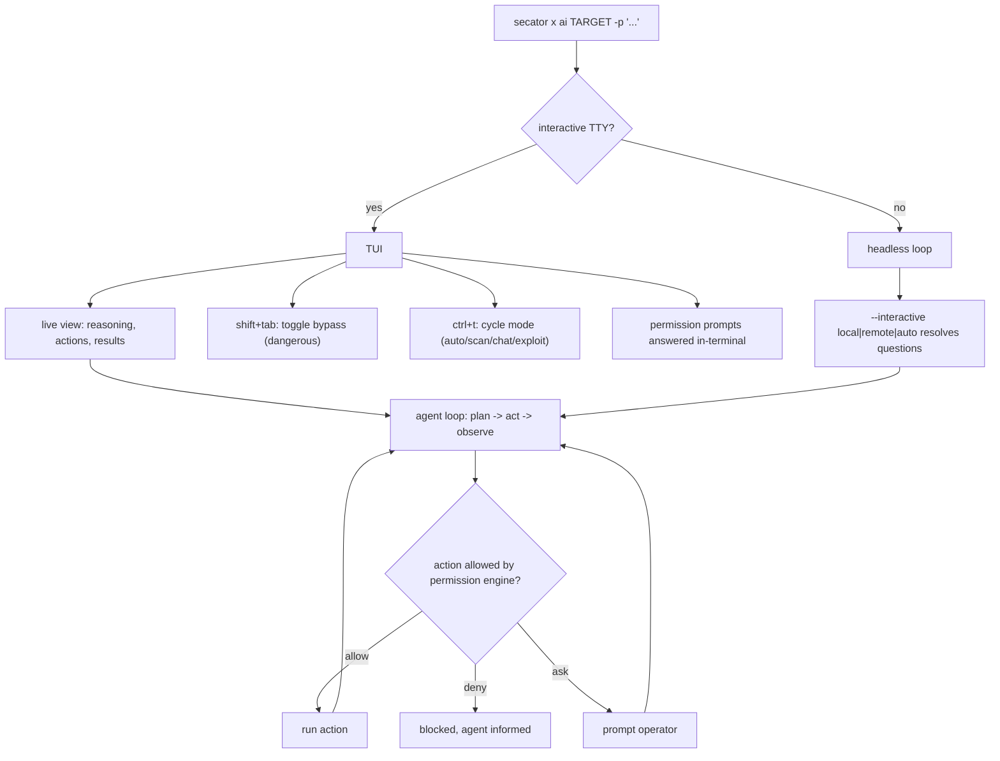
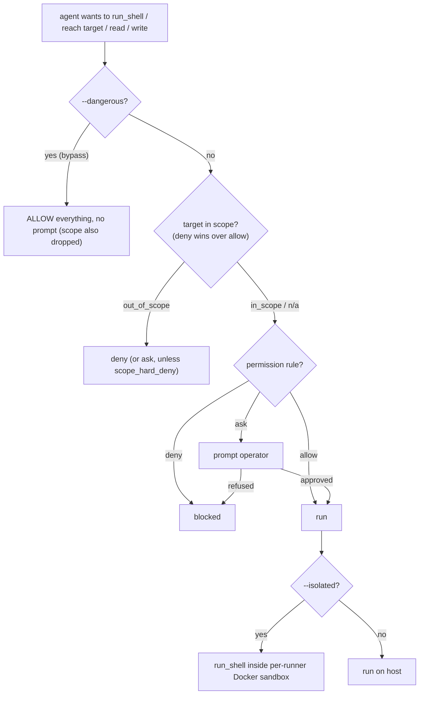

# AI task

The `ai` task is an autonomous security assistant that drives `secator` from
natural language. You give it a target and a prompt; it reasons in a loop,
runs `secator` tasks and workflows, executes shell commands, queries your
workspace findings, records results, and explains what it found - all under a
permission engine you control.

It is an ordinary `secator` task, so everything you know about targets, drivers,
workspaces, and output already applies:

```bash
secator x ai testphp.vulnweb.com -p "Scan this host for vulnerabilities"
```


**Only run the `ai` task against targets you are authorized to test.** The agent
can actively scan, fuzz, and attempt exploitation. Keep it inside a scope you
own or have explicit permission to assess (see [Scope](#scope)).


***

## Installation

The AI capabilities ship as an addon. Install it, then run the setup wizard to
pick a model and store your API key:

```bash
secator install addons ai
secator x ai setup
```

If the addon is missing, the task exits with a reminder to run
`secator install addons ai`.

***

## Execution paths: TUI vs headless

How a run behaves depends on whether you launch it interactively (with a TTY) or
headless. Interactively, the task opens a full-screen **TUI** where you watch the
agent reason, answer its permission prompts, and toggle its mode/guardrails live.
Headless (no TTY, or driven from a calling application / another task), it runs
the same agent loop but resolves questions through the configured
[`--interactive`](#interactive-modes) backend instead of the terminal. Pass
`--no-tui` to force the headless loop even on a TTY.



The TUI exposes two live toggles documented below: **shift+tab** toggles
[Dangerous mode (`--dangerous`)](#dangerous-mode) and **ctrl+t** cycles the
[mode (`--mode`)](#modes).

***

## Configuration

Configure the addon under the `addons.ai.*` keys. Every key is also settable via
an environment variable of the form `SECATOR_ADDONS_AI_<KEY>`.

```bash
secator config set addons.ai.default_model claude-sonnet-4-6
secator config set addons.ai.api_key sk-...
```

| Key | Default | What it does |
| --- | --- | --- |
| `api_key` | `''` | API key for the LLM provider. Env: `SECATOR_ADDONS_AI_API_KEY`. |
| `api_base` | `''` | Base URL of the LLM endpoint. Leave empty for the provider default. Env: `SECATOR_ADDONS_AI_API_BASE`. |
| `default_model` | `claude-sonnet-4-6` | Model used for the main agent loop. |
| `intent_model` | `claude-haiku-4-5` | Smaller/cheaper model used only to classify your prompt into a mode. |
| `temperature` | `0.7` | Sampling temperature for the agent. |
| `max_tokens` | `30000` | Per-response token cap. |
| `max_tokens_total` | `100000` | Hard conversation cap; the oldest messages are truncated beyond this. |
| `max_results` | `500` | Max workspace results returned to the agent per query. |
| `max_iterations` | `25` | Max agent-loop iterations. Set to `-1` (or any value `<= 0`) to **disable the cap** - the run continues until the model stops on its own (bounded by a high internal ceiling). |
| `context_window` | `128000` | Fallback context-window size for a model litellm doesn't know about. |
| `user_response_timeout` | `600` | Seconds the agent waits for an interactive answer before giving up. |
| `encrypt_pii` | `true` | Redact detected PII (emails, IPs, hostnames) before sending text to the LLM. |
| `custom_disallow_config_token` | `false` | When on, a caller-overridden `api_base` must come with its own `api_key` - the configured key is never reused on a different endpoint. |
| `permissions` | *(see [Permission engine](#permission-engine))* | The allow/deny/ask rules the agent runs under. |

Most of these have a matching run option so you can override them per run - e.g.
`--model`, `--api-base`, `--api-key`, `--temperature`, `--max-iterations`,
`--max-tokens-total`, `--intent-model`.

***

## Models and providers

The `ai` task uses [litellm](https://github.com/BerriAI/litellm) under the hood,
so any model litellm supports works - just set `default_model` (and the matching
provider key) accordingly.

To point the agent at a local or OpenAI-compatible endpoint (e.g. a self-hosted
model server), pass `--api-base` and `--model`:

```bash
secator x ai testphp.vulnweb.com \
  -p "Summarize the open ports" \
  --model openai/my-local-model \
  --api-base http://localhost:8000/v1 \
  --api-key sk-local
```


For a model litellm does not have registry info for (e.g. a custom/self-hosted
one), the task warns and falls back to `addons.ai.context_window` for the
context-window size. Set that config key to your model's real window.


***

## Modes

The agent operates in one of three modes. Each mode controls which actions the
agent is even allowed to attempt:

| Mode | What it can do |
| --- | --- |
| `chat` | **Read-only.** Read and explain workspace data (`query_workspace`), ask follow-ups, delegate a read-only subagent, and stop. It cannot run shell, tasks/workflows, or write findings. |
| `scan` | Actively scan: run tasks/workflows and shell commands, exploit, and write or curate findings. |
| `exploit` | Verify a single vulnerability by actually exploiting it and record a proof-of-concept. |

Select a mode explicitly with `--mode`:

```bash
secator x ai testphp.vulnweb.com -p "Enumerate the web app" --mode scan
```

In the TUI you can change mode live with **ctrl+t**.


The `scan` mode was previously called `attack`. The old name is still accepted
as an alias and maps to `scan`.


### Auto mode and self-escalation

If you don't pass `--mode` (or pass `auto`), the mode is **auto-detected** from
your prompt and **re-classified every turn**, so the agent follows the
conversation (chat ↔ scan ↔ exploit). A fast deterministic pre-classifier
handles unambiguous prompts; anything ambiguous is sent to the small
`intent_model`.

In an auto session the agent may **self-escalate** to a more capable mode when
the task needs it, via the `change_mode` action - for example, moving from
read-only chat into scan when you ask it to actually run a tool. Two guardrails
apply:

- An auto session **never silently de-escalates to `chat`** once it has entered
  an action mode (a mid-engagement aside won't strip its ability to record a
  finding).
- A **user-pinned `chat`** (you passed `--mode chat`) stays read-only - the
  agent cannot self-escalate out of it; it can only suggest that *you* switch.

A concrete `--mode` you pass is **pinned**: it sticks for the whole session and
the agent will not silently escalate out of it.

***

## Prompts and context

Provide the task with a prompt via `-p/--prompt`. The prompt may be a literal
string or a path to a file (local/CLI runs only):

```bash
secator x ai testphp.vulnweb.com -p "Find and rank the exploitable vulnerabilities"
secator x ai testphp.vulnweb.com -p ./prompts/engagement.txt
```

If you run interactively with no prompt, the task opens a full-screen prompt so
you can type one.

Pass structured context (findings, objective, scope hints) with
`--context` as a dict.

***

## Interactive modes

`--interactive` selects how the agent asks you questions mid-run:

- `local` (default for synchronous CLI runs) - prompts you in the terminal.
- `remote` - reads/writes answers through the workspace store, for headless runs
  driven by a calling application.
- `auto` - picks a backend automatically.

***

## Sessions and resume

Each run is a session. Name one with `-n/--name`, and resume a previous session
with `--resume`:

```bash
secator x ai testphp.vulnweb.com -p "Scan this host" --name webapp-assessment
secator x ai --resume
```

`--resume` shows a picker of prior sessions, restores the conversation and its
findings, and continues where you left off (re-detecting the mode from your next
message when the session was in auto mode).

***

## Subagents

In `scan`/`exploit` modes the agent can spawn an **autonomous subagent** (the
`run_subagent` action) to work a focused objective in a fresh context window and
hand back a summary. Each subagent runs with its **own conversation id** (its
transcript is separate from the parent's) and inherits the parent's remaining
iteration budget. Subagents run non-interactively and do not self-escalate.

***

## Tools and actions

Depending on the mode, the agent can call the following actions:

| Action | Purpose |
| --- | --- |
| `run_task` | Run a single `secator` task (e.g. `nmap`, `httpx`, `nuclei`, `ffuf`) against targets. |
| `run_workflow` | Run a `secator` workflow (a composed sequence of tasks). |
| `run_shell` | Run an arbitrary shell command for exploration, exploitation, or data analysis. |
| `query_workspace` | Query stored findings with MongoDB-style queries (every query must be targeted). |
| `run_subagent` | Spawn an autonomous subagent for a sub-objective. |
| `follow_up` | Ask you a clarifying question or present options. |
| `add_finding` | Record a new finding (vulnerability, exploit, URL, ...) in the workspace. |
| `mark_vuln_exploited` | Mark an existing vulnerability as exploited and attach a proof-of-concept. |
| `mark_vuln_exploit_failed` | Mark a real vulnerability it could not exploit this attempt. |
| `mark_vuln_false_positive` | Mark an existing vulnerability as a false positive. |
| `update_finding` | Update fields (severity, tags, CVEs, extra data) on an existing finding. |
| `change_mode` | Switch its own operating mode (auto / pinned-action sessions only). |
| `stop` | End the turn when the request is fulfilled or blocked. |

`chat` mode is restricted to `query_workspace`, `follow_up`, `run_subagent`,
`change_mode`, and `stop`.

Run tasks/workflows through the worker instead of inline with `--async-tasks`,
and tune batch concurrency with `--max-workers`.

***

## Output

The agent emits `Ai` output items for its prompts, reasoning/responses, each
action, tool results, follow-up questions, and stops, alongside the normal
`secator` finding output types (vulnerabilities, exploits, URLs, ports, ...)
that its tasks produce. Findings are persisted to the workspace like any other
`secator` result, so you can query them afterwards with `secator q`.

***

## Permission engine

Every action the agent attempts is checked against an allow / deny / ask rule
set before it runs. This is the core safety boundary, and it combines with the
optional [scope](#scope) boundary and [shell isolation](#shell-isolation).



Rules are grouped under `addons.ai.permissions` into `allow`, `deny`, and `ask`
lists. Each rule names an action class and a set of patterns:

- `target(<hosts/urls>)` - network targets the agent may reach.
- `read(<paths>)` - filesystem paths it may read.
- `write(<paths>)` - filesystem paths it may write.
- `shell(<commands>)` - shell command names it may run.
- `task(<names>)` / `workflow(<names>)` - runners it may invoke.

Two placeholders expand at runtime: `{targets}` (the run's targets) and
`{workspace}` (the run's workspace path). A leading `~/` expands to your home
directory.

**Evaluation order is `deny > allow > ask > default-deny`.** A deny always wins;
an unmatched action falls through to `ask` (you're prompted), and if nothing
matches at all it is denied.

The built-in defaults, roughly:

- **allow** the run's own targets and GitHub (for public PoC/exploit clones),
  reads/writes inside the workspace and `/tmp`, a curated list of common
  read-only and recon shell commands, and all tasks/workflows.
- **deny** cloud metadata/loopback targets, reads of host secrets
  (`/etc/shadow`, `~/.ssh/*`, `~/.aws/*`), writes to system paths, and
  destructive commands.
- **ask** for anything else - arbitrary targets, interpreter/compiler shell
  commands (`python`, `bash`, `node`, `gcc`, ...), and arbitrary reads/writes.

The agent is also told in its system prompt never to touch host secrets,
environment variables, the `secator` config, or the workspace database -
exploiting the *target* is in scope; exploiting the host running `secator` is
not, and such actions are blocked regardless of what the prompt says.

### Guardrail levels at a glance

The flags combine into escalating trust levels - from "gate everything" to
"trust the LLM". Each row shows which guardrail layers still apply:

| Mode | Command | Path | Target / scope | Approval prompts | Shell isolation |
|---|:---:|:---:|:---:|:---:|:---:|
| **default** | ✅ gated | ✅ gated | ✅ gated | yes | no |
| **`--in-scope` / `--out-of-scope`** | ✅ | ✅ | ✅ in-scope pre-approved | fewer¹ | no |
| **`--isolated`** | ❌ dropped² | ❌ dropped² | ✅ still enforced | targets only | ✅ Docker sandbox |
| **`--dangerous`** | ❌ | ❌ | ❌ scope dropped too | none | no |

¹ In-scope targets are pre-approved, so they don't prompt; out-of-scope targets
are denied (or prompt, unless `scope_hard_deny` is set). ² The sandbox container
*is* the command/filesystem boundary, so those layers drop to *allow* - but
network egress (targets) and sensitive-env access still gate.

### Dangerous mode

`--dangerous` skips **all** permission checks. Use it only in a throwaway, fully
isolated environment you control:

```bash
secator x ai testphp.vulnweb.com -p "..." --dangerous
```

In the TUI you can toggle it live with **shift+tab** (it flips the "bypass
guardrails" / "guardrails enforced" banner).


`--dangerous` removes the entire safety boundary. It **also disables scope
filtering** - `--in-scope` / `--out-of-scope` are intentionally dropped when
`--dangerous` is on, so nothing is filtered as out-of-scope and child runners
inherit no scope boundary. The agent can then run any shell command, reach any
target, and read/write any path the process can. Never use it against a shared
host or a target you don't fully own.


***

## Scope

On top of the permission rules you can give the run a hard target boundary with
`--in-scope` (an allow-list) and `--out-of-scope` (a deny-list). Deny wins over
allow, and out-of-scope targets are dropped from the run inputs entirely:

```bash
secator x ai app.example.com \
  -p "Assess this app" \
  --in-scope app.example.com,api.example.com \
  --out-of-scope admin.example.com
```

In-scope hostnames are resolved to their current IPs so the agent can reach an
in-scope host by either name or IP. The scope applies both to the AI run itself
and to **every child task/workflow the agent spawns** - each child runner
force-inherits the parent's `in_scope` / `out_of_scope`, so the agent cannot
escape the boundary by delegating. The active scope is injected into the system
prompt so the agent knows its boundaries and won't retry a denied target.

By default an out-of-scope network target that the agent tries falls through to
an interactive `ask`. Setting `security.scope_hard_deny`
(`SECATOR_SECURITY_SCOPE_HARD_DENY=1`) makes any out-of-scope network target a
hard deny instead of a prompt.


Scope only applies while the permission engine is active. As noted above,
[`--dangerous`](#dangerous-mode) currently disables scope filtering entirely.


***

## Shell isolation

`--isolated` runs every `run_shell` command inside a **per-run Docker container**
(Docker-in-Docker) instead of on the host. The container becomes the
command/filesystem boundary, so shell-command and path permission prompts are
dropped - but **target (network egress) and sensitive-env checks still apply**.
The sandbox container is torn down when the turn ends.

```bash
secator x ai testphp.vulnweb.com -p "..." --mode exploit --isolated
```

This requires Docker to be available. The default comes from
`security.shell_isolated` (`SECATOR_SECURITY_SHELL_ISOLATED=1`), so a sandboxed
worker can force isolation on for every AI run.

***

## PII encryption

By default (`--sensitive`, config `addons.ai.encrypt_pii`) the task redacts
detected PII - emails, IPv4 addresses, and hostnames - replacing them with
reversible placeholders before any text is sent to the LLM, and restoring the
originals in output. Disable with `--no-sensitive` if you need the raw values in
the transcript (for example when the model must reason about exact hostnames).

***

## Guardrails and limits

Several limits keep a run bounded and observable:

- **Iteration cap** - `--max-iterations` (default `25`). `-1` disables the user
  cap but a high internal ceiling still bounds a runaway loop. Each mode also
  imposes a floor.
- **Token caps** - `max_tokens` per response and `max_tokens_total` for the
  whole conversation (oldest messages truncated beyond it).
- **Context warnings** - on by default (`--context-warnings` /
  `--no-context-warnings`); the task warns as the context window fills (around
  50% / 75%) and auto-summarizes older history past a high threshold.

***

## Natural-language queries with `secator q`

`secator q <arg>` resolves its argument in three steps - a saved query name, a
filter expression, and otherwise **natural language**, which is routed to the
`ai` task in `chat` mode:

```bash
secator q "Show me the top 5 vulnerabilities in my workspace"
secator q "Analyze my workspace data"
```

This is the quickest way to ask read-only questions about your findings without
typing a full `secator x ai ... --mode chat` command (run `secator x ai setup`
first to configure a model).

***

## Sample use case: scope, review, exploit

A realistic end-to-end session: hunt vulns on a scoped target, review findings in
read-only chat, then exploit one in an isolated sandbox.

**1. Hunt, inside a hard scope.** Scan `app.example.com` but never let the agent
(or its child runners) wander to the admin host:

```bash
secator x ai app.example.com \
  -p "Find and rank the exploitable vulnerabilities" \
  --mode scan \
  --in-scope app.example.com,api.example.com \
  --out-of-scope admin.example.com \
  --name example-engagement
```

The agent runs recon/scan tasks (nmap, httpx, nuclei, ...), records findings into
the workspace, and stays within scope. Anything outside scope is blocked; anything
the permission engine is unsure about prompts you.

**2. Review, read-only.** Ask questions about what it found without any risk of a
write or scan - `chat` is read-only:

```bash
secator x ai app.example.com -p "What are the top 3 findings and why?" --mode chat
```

(You can also use `secator q "Show me the top 5 vulnerabilities in my workspace"`,
which routes natural language to the `ai` task in `chat` mode.)

**3. Exploit one, in isolation.** Verify a single vulnerability by actually
exploiting it, with every shell command sandboxed in a disposable Docker container:

```bash
secator x ai app.example.com \
  -p "Prove exploitability of the SQLi on /search and record a PoC" \
  --mode exploit \
  --isolated
```

The agent attempts the exploit inside the sandbox, and on success calls
`mark_vuln_exploited` to attach a proof-of-concept to the finding.

***

## Diagnostics

- `--show-prompt` renders the system prompt for the selected mode and exits -
  useful for inspecting exactly what the agent is told (including the active
  scope).
- `--dry-run` shows what the agent would do without executing actions.

```bash
secator x ai testphp.vulnweb.com --mode scan --show-prompt
```

***

## Library usage

Like any `secator` task, `ai` can be driven from Python:

```python
from secator.tasks import ai

task = ai('testphp.vulnweb.com', prompt='Scan this host for vulnerabilities', mode='scan')
for item in task:
    print(item)
```
